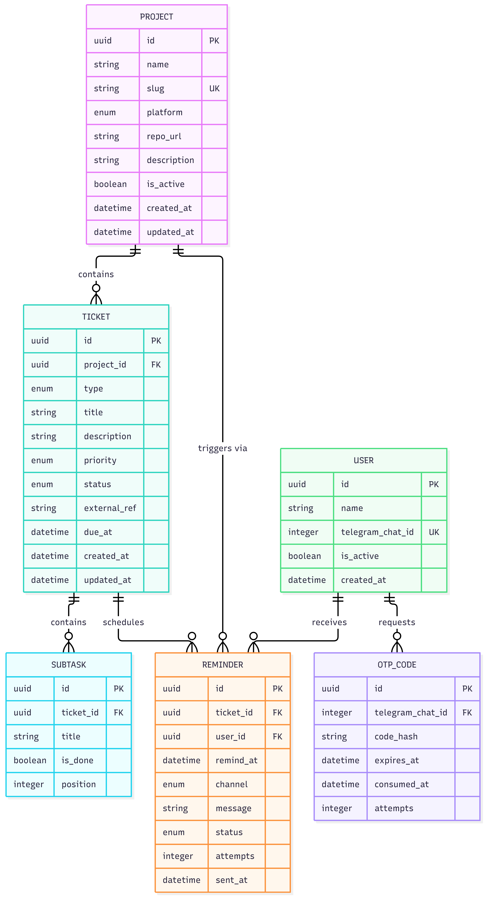

# Tickets Management App

## Problema

La aplicacion resuelve un problema basico de equipos y solo developers, basicamente tener todos los requerimientos, issues o tickets de multiples plataformas y proyectos en un solo lugar, ademas de poder priorizar y ser notificado cuando alguno necesita alguna atención especial.

## Alcance

1. Autenticación por OTP vía Telegram
2. RestAPI usando FastAPI
2. Registro de tickets con prioridad, tags, subtareas y recordatorios
3. Despligue en AWS
4. Observabilidad despues de despliegue

## Diagrama

